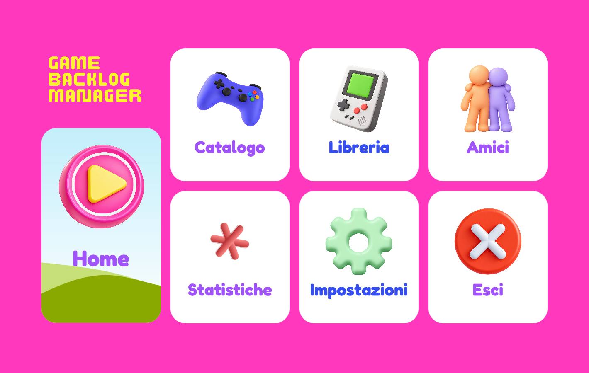
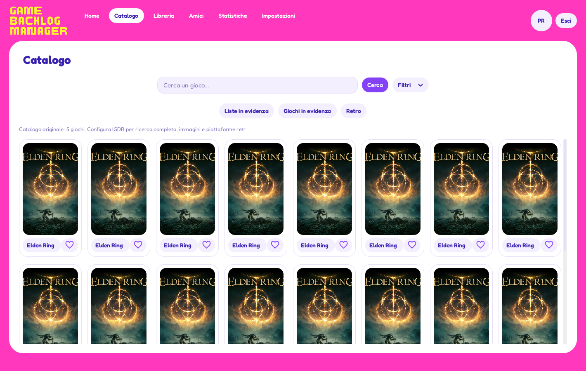
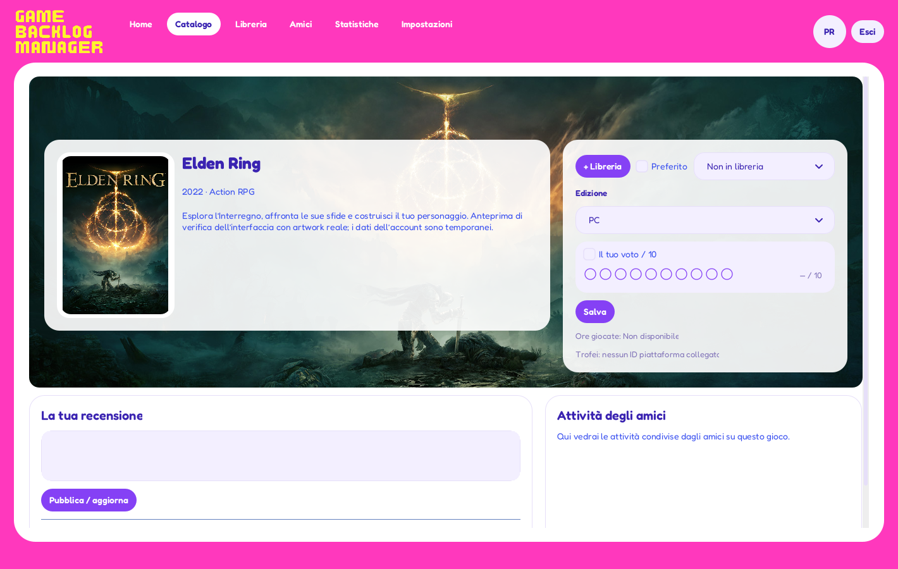
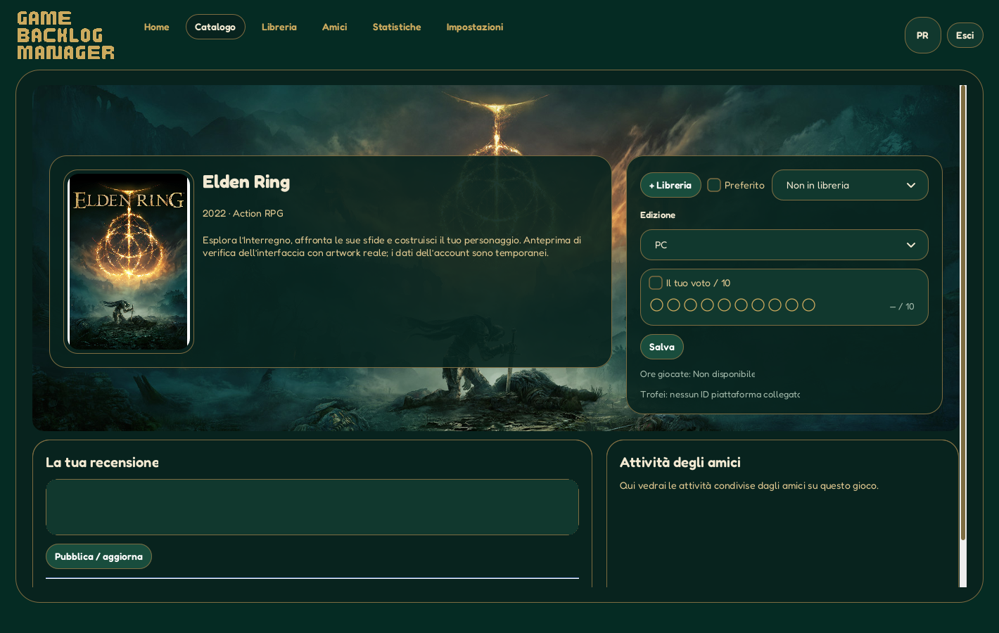
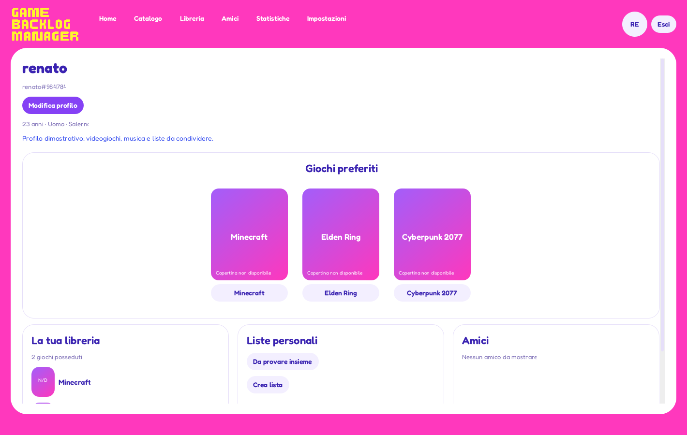
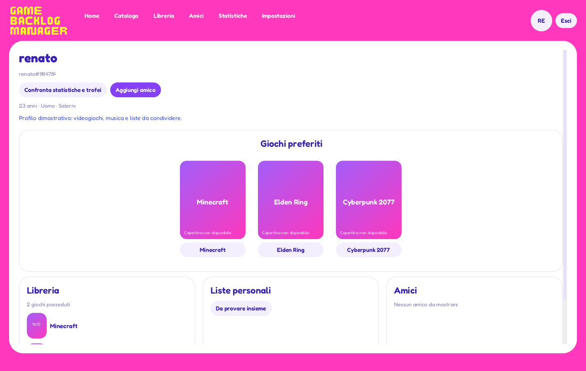
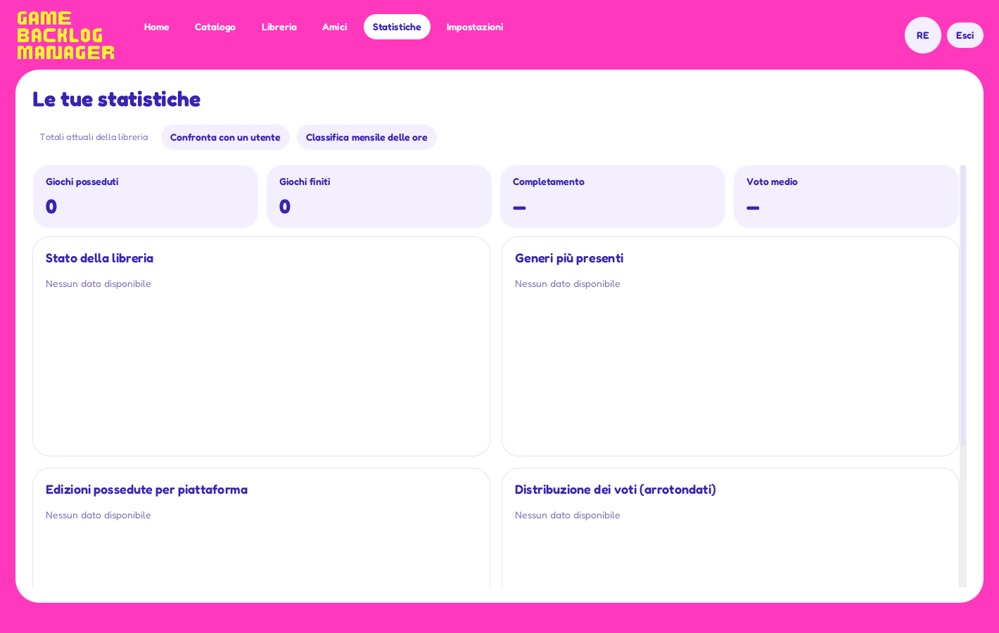

# Correzioni grafiche · 2.6 beta

Il menu iniziale ora è composto da pulsanti reali, con pannelli e testi disegnati nativamente. Non viene più ingrandita l’intera immagine del menu. Le icone originali sono conservate e visualizzate senza superare la risoluzione disponibile, considerando anche la densità dello schermo. Non si promette di ricostruire dettagli assenti nelle immagini originali.

Il logo usa nuovamente i pixel originali del riferimento, con sfondo trasparente e ridimensionamento nearest-neighbor per conservarne l’aspetto. Non viene sostituito da contorni smussati o da un altro font e non contiene joystick aggiunti. Il resto dell’interfaccia usa Fredoka incorporato, con pesi statici derivati dalla famiglia ufficiale Google Fonts; la licenza OFL è inclusa.

Campi email e password, menu a tendina, checkbox, spinner del voto, pulsanti, cuori e barre di scorrimento condividono font, colori e geometria. I cuori sono icone vettoriali, non caratteri mancanti nel font. I bordi dei riquadri usano la stessa sagoma dello sfondo; il campo recensione è ritagliato correttamente agli angoli.

Le copertine IGDB richiedono la variante 2x; le immagini panoramiche usano la variante 1080p. Steam usa library_hero quando disponibile e ripiega su header. Il rendering applica interpolazione bicubica e maschere arrotondate alla densità effettiva del display. Il ritaglio mantiene le proporzioni. Le immagini non disponibili sono segnaposto dichiarati: senza credenziali IGDB non compaiono copertine reali.

## Verifica

Schermate renderizzate a 1420×900 e 1100×760, più verifica del rendering al 200%. Test aggiuntivi: font condiviso, caricamento del logo, pulsanti del menu e aree cliccabili, assenza di sovrapposizioni, azione Esci, risoluzione del buffer immagini e trasparenza degli angoli. I test precedenti di account, social, privacy, provider e SQL restano superati.

Le immagini in questa cartella mostrano il programma reale con dati di test locali; non sono concept generati. La verifica è stata eseguita su Linux con Java 17, non su un desktop Windows reale.

## Correzioni 2.3

I pannelli verticali applicano spaziatura e allineamento anche ai componenti aggiunti successivamente. I campi dei moduli e la checkbox condividono lo stesso margine sinistro. I pulsanti mantengono la larghezza del contenuto; l’avatar ha dimensioni quadrate e forma circolare. Le icone Statistiche ed Esci sono ricavate da ritagli completi. Home non disegna più un fondo bianco sotto il bordo azzurro.

La pagina gioco separa banner, intestazione e riquadri recensione. Il selettore dell’edizione varia la sagoma della copertina in base ai formati fisici più comuni della piattaforma (es. Switch, DS, custodie DVD e jewel case). Le proporzioni sono valori predefiniti: edizioni e regioni possono avere custodie differenti. L’immagine originale viene adattata senza deformarla o ritagliarla.

## Correzioni 2.4

I pulsanti calcolano la larghezza dal testo e dalle icone, senza dipendere dai margini del tema Windows. Il placeholder usa una grafica separata dal delegato del campo, con inset e baseline coerenti; scompare al focus per non sovrapporsi al cursore. Il ritaglio dell’icona Statistiche include margine su tutti i lati. Il voto usa cinque stelle, mezze stelle e valore numerico su dieci.

Il tema scuro usa verde RGB(43,91,22), logo oro RGB(217,160,30), superfici verde molto scuro e testo crema. Il logo conserva gli stessi pixel e cambia solo colore. Il tema è opzionale e memorizzato sul computer.

## Correzioni 2.5

La misurazione e il disegno delle scritte dei pulsanti ora condividono lo stesso contesto tipografico e non demandano margini e troncamento al tema di Swing. Test su Metal/Nimbus e scale diverse; non è una verifica su Windows reale. L’icona Statistiche è ricostruita con bracci interi e terminali arrotondati.

La scheda gioco riprende la prima bozza: banner panoramico, copertina sovrapposta in modo controllato, riepilogo centrale, comandi a destra e voto con dieci cerchi. Edizioni possedute, stati, preferiti e trofei conservano le rispettive funzioni. Recensioni e attività sono affiancate.

Il nuovo tema scuro è un’anteprima da approvare: smeraldo profondo, oro caldo, bordi sottili. Il tema chiaro resta quello iniziale. Le copertine segnaposto restano esplicite fino alla configurazione IGDB.

## Correzioni 2.6 e anteprima profilo

Tolto il placeholder del campo email; l’etichetta esterna resta. Ridotta l’icona Statistiche. Su richiesta successiva dell’utente, è ripristinata la sovrapposizione della copertina sul banner come nella bozza approvata. Il cambio di edizione modifica i componenti sul posto e conserva la bozza della recensione e il voto non ancora salvato; non ricrea la finestra né esegue richieste di rete. Il voto non mostra più spinner o frecce. Il logo, anche cliccando direttamente sulla sua immagine, torna al menu. I messaggi dei grafici vuoti stanno in alto a sinistra. Il tema scuro approvato è indicato semplicemente come Modalità scura.

Il nuovo profilo è un’anteprima da approvare. Mostra preferiti centrati, anteprima della libreria, liste personali e amici. L’avatar apre il proprio profilo; si possono modificare nome, età, sesso, provenienza e bio. I campi biografici sono facoltativi e pubblici; la finestra lo specifica prima del salvataggio. La libreria e i preferiti rispettano la visibilità impostata. Le liste private sono mostrate solo al proprietario. La vista di un altro utente usa la stessa disposizione, senza comando di modifica.

Test API: validazione, salvataggio atomico, persistenza, esclusione delle credenziali, liste private e impossibilità di modificare un altro account. Test visuali: cambio ripetuto di edizione con menu aperto e risposta dell’EDT entro quattro secondi; clic sul logo; entrambe le modalità di colore. Eseguiti su Linux, da riconfermare su Windows. Schermate con dati dimostrativi.

## Versione 2.7

Banner come sfondo dell’intera sezione superiore. Informazioni e comandi raccolti in due pannelli semitrasparenti. Copertina fissa per tutte le edizioni. Griglia a otto colonne alla dimensione standard, con riduzione automatica al diminuire dello spazio o all’aumentare della scala testo. Icone menu sostituite e normalizzate tramite il solo canale alpha.

Le schermate menu.png, catalogo.png, gioco.png e tema-scuro.png sono aggiornate; catalogo e scheda usano artwork reale Steam con dati locali temporanei per le verifiche visive. Le altre schermate preesistenti restano riferite alla versione precedente.
